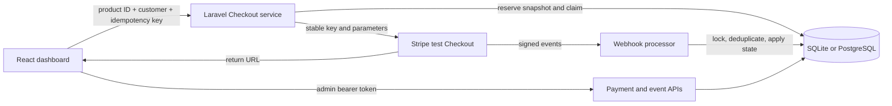

# Architecture

## Runtime boundaries

React/Vite provides the operations dashboard and Checkout return page. Laravel is a modular monolith with a database catalog, Checkout service, verified-event processor, test refund service, and Sanctum administration. SQLite is supported for local development; the Render deployment uses PostgreSQL. Stripe hosts Checkout and delivers signed test events.

The current data model contains products, payments, webhook events, users, and access tokens. A payment owns its customer/product/price snapshot; there is no separate order domain. Secret keys remain server-side. The browser sends a product ID and customer identity, and Laravel resolves pricing from the database.

## Checkout consistency

`CheckoutService` separates durable reservation, a short processing claim, the external call, and final persistence. A unique client key identifies the payment; its SHA-256 fingerprint binds the original product, customer, and demo/Stripe mode. Immutable Stripe parameters preserve the price and return URLs when catalog/configuration changes during recovery.

Claims expire after two minutes. A duplicate active request returns retryable 409 rather than waiting behind an external call. A crashed worker can recover with the same Stripe key; successful remote creation followed by local-save failure does not require a new payment. Finalization checks claim ownership and preserves a webhook-confirmed terminal state. Pending recovery stops after 23 hours to stay within Stripe's minimum key-retention window. Legacy rows without fingerprints reject replay.

PostgreSQL integration workers synchronize before INSERT to exercise the unique-key race and savepoint recovery. A separate overlap scenario holds the gateway open while another request checks the claim. The gateway is fake; the transactions, row locks, and independent database connections are real.

## Payment and event state

Payment transitions are `created → processing → succeeded | failed`. Confirmed success can recover a failed payment. Verified full-refund events can move it to `refunded`, even before success arrives. Succeeded payments never regress to processing/failed; refunded is terminal. Repeated confirmations preserve original payment/refund timestamps. A completed Checkout Session remains processing until payment status is paid or no_payment_required.

Webhook delivery state is independent: `received → processed | ignored | failed`. Signatures are verified before any event is stored. The processor locks event/payment rows and deduplicates event IDs. Every processing attempt increments the delivery counter. Unsupported events and regressive transitions are ignored; unmatched supported events remain failed and return 500 for Stripe redelivery.

Payment-level manual retry selects the oldest associated received/failed verified event and replays its stored snapshot. One request processes one event. No stored event returns 422; a processing failure returns 503. Stripe controls automatic redelivery; there is no application retry scheduler.

## Browser behavior

`VITE_USE_API=false` selects explicit local simulation. In API mode there is no sample catalog substitution after a connection error and no fabricated successful checkout. Pending Checkout keys persist per product in sessionStorage; authentication tokens stay in memory.

Private records load only after administrator sign in, in pages of up to 100. Search, filters, and metrics apply to loaded records. Monetary totals are grouped by currency. Refresh resets lists to the first page. Late responses from an ended admin session cannot restore private data; detail requests also track selection order.

Checkout returns show pending, successful, failed, refunded, cancelled, and unavailable states. Returning through the success URL alone does not establish payment success. Session refresh does not mutate the webhook-backed payment state.

## Security and deployment

Administrative APIs require a persisted admin role and Sanctum token with the admin ability. Tokens expire after one hour and are revoked on logout. The UI clears records on 401/403 or expiry. Login is rate limited. Administrators are provisioned privately via CLI or optional first-deployment seeding; there is no public registration/default password.

Vercel serves the frontend. Render builds the production PHP image, injects database credentials, and migrates/seeds at startup. PostgreSQL remains private to the API. HTTPS, narrow CORS, environment secrets, backups, and appropriate hosting plans are necessary for any long-lived deployment.

## Scope and trade-offs

This is a low-traffic, single-region portfolio demo. A relational database and synchronous Checkout request are sufficient; the design does not introduce queues, replicas, or service splits. Bounded network calls and durable recovery improve correctness without holding database locks during Stripe requests. Global analytics, live payments, partial refunds, subscriptions, background reconciliation, and formal compliance certification are outside the current scope.
