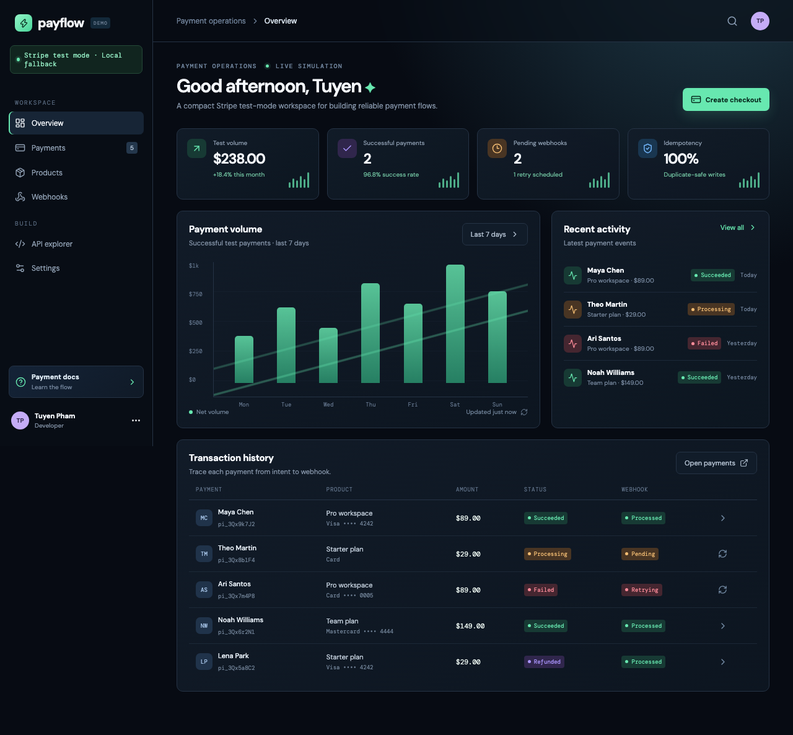

# Stripe Payment Demo

Personal/demo project showing a Stripe test-mode payment flow with checkout creation, transaction history, webhook states, idempotency, and recovery paths. It is not a production payment system and makes no live-payment claims.

## Run the frontend demo

```bash
npm install
npm run dev
```

Then open the Vite URL shown in the terminal. The UI connects to the Laravel API when it is available. If the API is offline, it falls back to local demo data so the interface remains reviewable.

## Run with Laravel API

```bash
cd backend
php artisan migrate
php artisan serve --port=8000
```

In a separate terminal, start the frontend with `VITE_USE_API=true` (the default). Vite proxies `/api` to `http://127.0.0.1:8000`. For a separately hosted API, set `VITE_API_URL` to its `/api` URL.

## Verify

```bash
npm run build
```

The build is the current automated smoke check. Before a live Stripe integration, add PHPUnit/API tests for signature verification, duplicate events, idempotency, and payment state transitions.

## Planned Laravel integration

The backend is a Laravel modular monolith using Stripe Checkout in test mode. With `STRIPE_SECRET` configured, checkout creation returns a Stripe-hosted Checkout URL and the browser redirects there. Configure the Stripe CLI to forward events to `/api/webhooks/stripe`:

```bash
stripe listen --forward-to 127.0.0.1:8000/api/webhooks/stripe
```

Copy the CLI `whsec_...` value into `STRIPE_WEBHOOK_SECRET`. Keep `STRIPE_SECRET`, `STRIPE_WEBHOOK_SECRET`, and database credentials in `.env`; never commit them. The API explorer in the demo shows the server-side PaymentIntent request and its `Idempotency-Key`.

Use Stripe's test card `4242 4242 4242 4242` only in Stripe test mode, with any future expiry and any CVC. Do not enter real card data.

## Portfolio evidence

See [docs/PORTFOLIO.md](./docs/PORTFOLIO.md) for a reviewer walkthrough, architecture flow, evidence map, and dashboard screenshot.



## Portfolio label

`Personal Project` / `Demo Project`.
