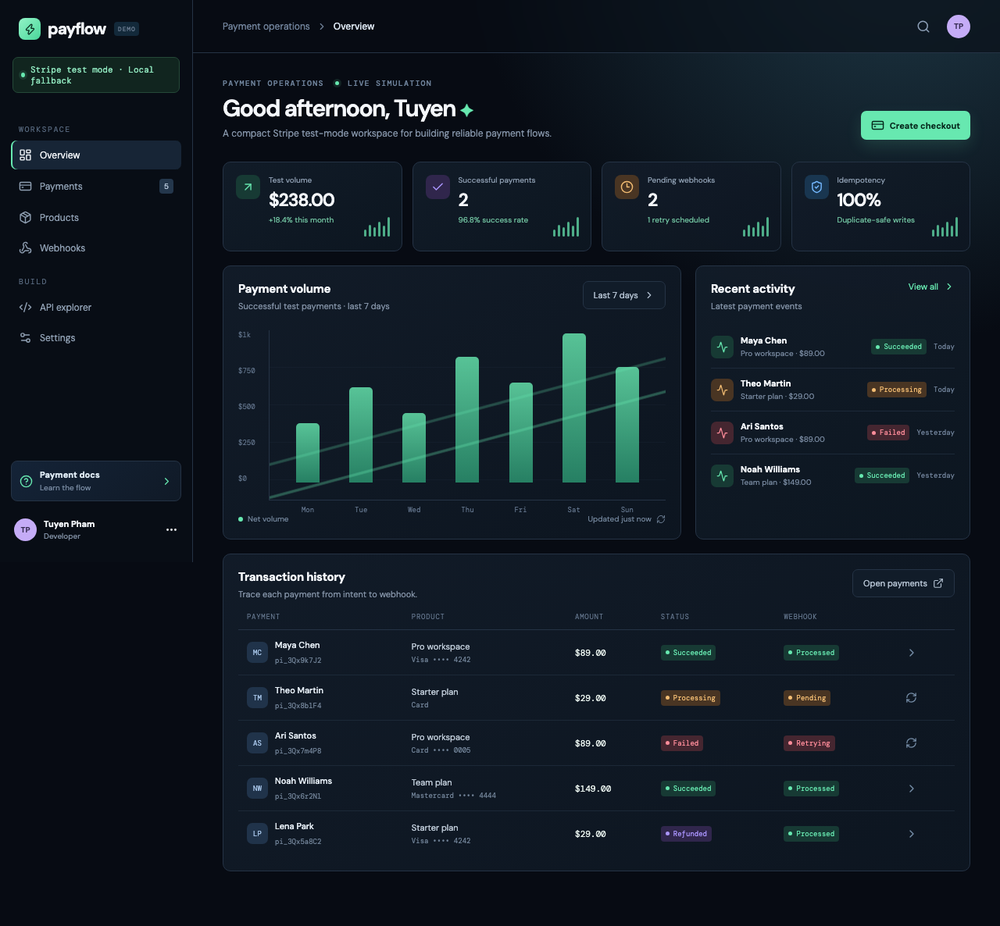
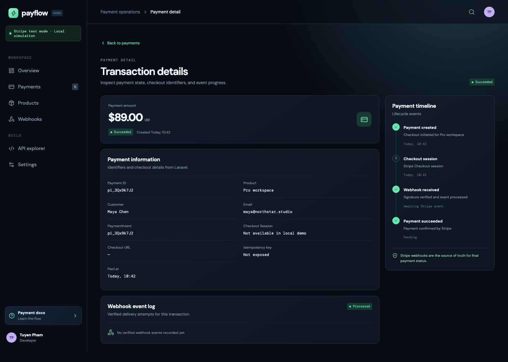

# Portfolio evidence

> **Personal Project / Demo Project** — Stripe Payment Demo

## What this demonstrates

This project demonstrates a test-mode payment flow with a React/Vite operations console and Laravel API. The implementation covers Stripe Checkout Session creation, server-side idempotency, signed webhook verification, duplicate-event handling, transaction state transitions, and retry recovery.

The product catalog is stored in Laravel's database and seeded for the demo. Checkout accepts a product ID; the backend resolves the product's name, price, and currency so client supplied pricing cannot change the charge.



### Payment detail

The detail view shows payment identifiers, customer and product information, webhook delivery state, and the payment lifecycle timeline.



## Reviewer walkthrough

1. Start the Laravel API and Vite frontend using the commands in the root README. Create an administrator privately with `php artisan admin:create EMAIL` and choose **Admin sign in** to inspect protected payment records.
2. Open **Overview** and choose **Create checkout**.
3. Select a demo product. With test credentials configured, the browser redirects to Stripe-hosted Checkout.
4. Use Stripe test card `4242 4242 4242 4242`, any future expiry and any CVC.
5. Forward events with Stripe CLI and return to the dashboard to inspect `succeeded`, `failed`, `pending`, and `processed` states.
6. Open **Webhooks** to inspect delivery state and retry a pending event.
7. Open **API explorer** to review the server-side PaymentIntent/idempotency contract.

## Evidence map

| Area | Evidence in repository |
| --- | --- |
| Payment detail endpoint | `GET /api/payments/{id}` returns the transaction record for the detail page. |
| Protected administration | Sanctum bearer authentication with a one-hour expiry, admin role/ability checks, rate limited sign in, and token revocation; `backend/tests/Feature/AdminAuthTest.php`. |
| Administrator UI | In-memory token, sign in/out, expired-session cleanup, and late-response protection covered by `e2e/admin-auth.spec.js` using mocked API responses. |
| Payment detail interface | `src/main.jsx` and `src/styles.css` |
| Checkout result page | React handles Stripe success/cancel redirects and checks session status via `GET /api/checkout/sessions/{sessionId}`. |
| Test-mode refunds | `backend/app/Services/StripeRefundService.php` and `POST /api/payments/{payment}/refund`; live keys are rejected. |
| Refund webhook state | `charge.refunded` and `refund.updated` are handled by `backend/app/Services/StripeWebhookProcessor.php`. |
| Checkout creation | `backend/app/Http/Controllers/Api/PaymentController.php` |
| Database product catalog and endpoint | `backend/app/Models/Product.php`, `backend/database/seeders/ProductSeeder.php`, and `GET /api/products` |
| Checkout Session persistence | `backend/database/migrations/2026_11_10_000002_add_checkout_fields_to_payments_table.php` |
| Signature verification | `backend/app/Http/Controllers/Api/StripeWebhookController.php` |
| Duplicate event protection and delivery attempts | `backend/app/Services/StripeWebhookProcessor.php` and `backend/tests/Feature/PaymentApiTest.php` |
| Persistent webhook event log | `backend/app/Models/WebhookEvent.php`, its migration, and `GET /api/webhook-events` |
| Checkout recovery and idempotency | `backend/tests/Feature/CheckoutRecoveryTest.php`: timeout/local-save recovery, immutable Stripe parameters, input conflicts, expired claims, safe retry window, and SDK request contract. |
| Concurrent checkout on PostgreSQL | `backend/tests/Integration/checkout-concurrency.php` runs independent workers inside the deployment image in CI with a fake gateway. |
| Browser checkout failures | `e2e/checkout-recovery.spec.js`: pending-state controls, error display, and same-key recovery across reload. |
| Retry and failure recovery | `backend/app/Http/Controllers/Api/PaymentController.php` |
| Responsive interface | `src/main.jsx` and `src/styles.css` |
| Reproducible deployment | `DEPLOYMENT.md`, `render.yaml`, `backend/Dockerfile`, `vercel.json` |
| Automated verification | `.github/workflows/ci.yml` |

## Architecture flow

```mermaid
flowchart LR
  Browser[React/Vite dashboard] -->|POST /api/payments/checkout| API[Laravel API]
  API -->|Checkout Session, test mode| Stripe[Stripe Checkout]
  Stripe -->|redirect| Browser
  Stripe -->|signed events| Webhook[/api/webhooks/stripe]
  Webhook -->|verify + lock + dedupe| DB[(Payments database)]
  Browser -->|GET payments / retry webhook| API
```

## Honest scope

This is a personal demo. It uses Stripe test mode only and does not claim production payment volume, real customer revenue, compliance certification, or live operational availability. The Render Blueprint provisions managed PostgreSQL on its free evaluation plan; upgrade the database plan for long-term retention.
